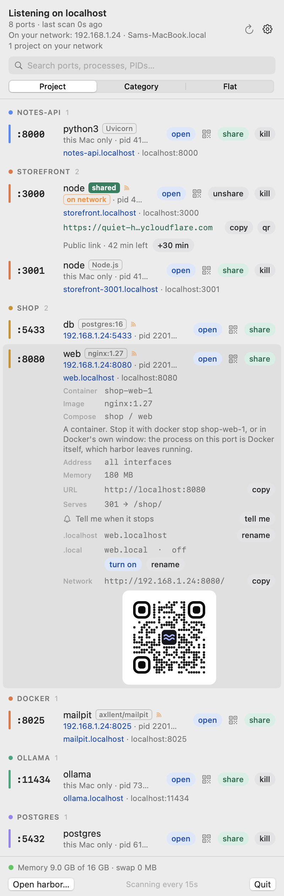
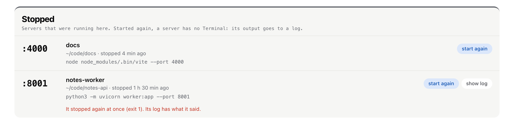
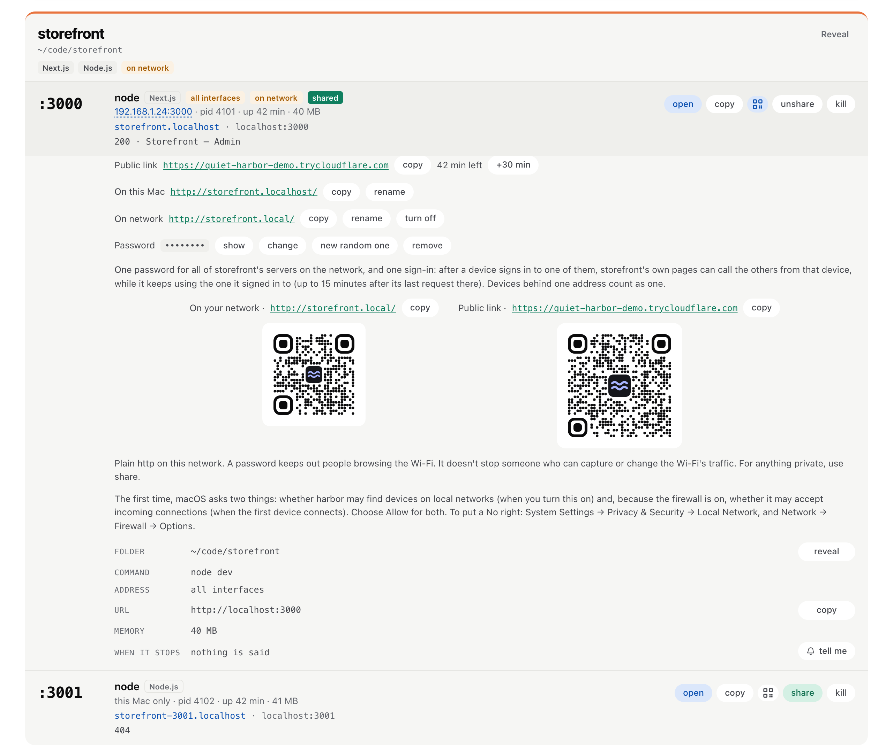

# harbor

Manfath was eating 25–40% of my CPU just to show which ports were open, because it ran `lsof`
every 10 seconds. So I made harbor. It sits in the menu bar, shows every server listening on my
Mac, and lets me open, copy, share or kill each one. It reads everything straight from the
kernel, so it idles at about 0% CPU.

<picture>
  <source media="(prefers-color-scheme: dark)" srcset="docs/screenshots/ports-dark.png">
  
</picture>

## What it does

**Ports**
- Lists every server listening on this Mac, in the menu bar and on a page at `harbor.localhost`.
- Groups them by project folder, by kind (dev servers, databases, runtimes…) or in one flat list.
- Open, copy, QR code, share and kill on every row. Kill asks first.
- Shows what a web server answers beside its row: `200 · Storefront`, `301 → /login`, `500`.
- Shows Docker's published ports as their containers, grouped by compose project.
- A bell on any server: one notification when that server stops.
- Servers that stopped stay in a "Stopped" list for a day, with **Start again**.
- A port range, "servers only", hidden process names, and macOS's own services on request.

**Names**
- Every project gets `<folder>.localhost`, so `~/code/storefront` opens at `storefront.localhost`.
- A project's other servers get the port on the end; I can rename any of them and pick the main one.

**On your network**
- Puts a server on my Wi-Fi as `storefront.local`, behind a password, with a QR code for my phone.
- One password and one sign-in per project. It can stop by itself after 30 minutes or an hour.

**Public links**
- A public link through a Cloudflare quick tunnel (or ngrok), with a QR code.
- It ends after an hour unless I choose 30 minutes or "until I stop it". "+30 min" adds time.

**This Mac**
- Memory and swap, the apps holding the most memory, and a warning when stuck processes pile up.
- The menu bar icon turns orange or red when memory gets tight.

**Command line**
- `harbor ls`, `harbor kill <port>` and `harbor open <port|name>` in Terminal.

**Updates**
- When a new version is out, **Update now** replaces the app where it is.

## Getting started

You need macOS 14 or newer.

1. **Check which Mac you have.** Apple menu → About This Mac. If it says "Chip" (Apple M1, M2…)
   you have Apple Silicon. If it says "Processor" (Intel Core…) you have Intel.
2. **Download the zip** from the [latest release](https://github.com/ips610/harbor/releases/latest),
   under Assets:
   - `harbor-apple-silicon.zip` for Apple Silicon
   - `harbor-intel.zip` for Intel
3. **Unzip it.** Safari does this by itself. Otherwise double-click the zip in Downloads. You get
   `harbor.app`. If you want to check the download, the release also has a `SHA256SUMS` file; in
   the Downloads folder run `shasum -a 256 -c SHA256SUMS` and it should say `OK`.
4. **Move it to Applications.** Drag `harbor.app` onto Applications in the Finder sidebar.
   Typing `harbor.localhost` only works once it runs from Applications.
5. **Open it the first time.** Double-click harbor in Applications. macOS says it can't check the
   app for malware, because I haven't paid Apple to notarise it. Click **Done** (not Move to
   Trash). Then open System Settings → Privacy & Security, scroll down to Security, and next to
   "harbor was blocked" click **Open Anyway**. Enter your password and click **Open Anyway** once
   more. You only do this once per download.
6. **Find it.** The waves icon appears in the menu bar, and harbor opens its page at
   `harbor.localhost` in your browser. macOS may say it added a background item: that's the small
   helper that lets you open harbor by typing the address. The first time you quit an app from
   harbor, macOS asks whether harbor may control it; allow it, or Quit won't work.
7. **Use it.** Click the waves for the list of ports, or keep the page open. Every row has open,
   copy, QR, share and kill. The gear menu has the port range, how often it refreshes, Open at
   login (off by default) and Show in Dock.

Only one harbor runs at a time; opening it again just brings up the page.

Two more prompts come later, and only if you use the thing they belong to. The first time you
put something on your network, macOS asks whether harbor may find devices on local networks,
and, if the firewall is on, whether it may accept incoming connections. Both need Allow.

## Using it

### The menu and the page

<picture>
  <source media="(prefers-color-scheme: dark)" srcset="docs/screenshots/menu-dark.png">
  
</picture>

The menu bar dropdown works like Manfath: the ports, with open, share and kill on every row.
Click a row for its details. Kill asks "confirm?" first and tells you which process and folder
it's about to stop. It sends a normal quit; force kill is only offered if that didn't work.

For the full view, open harbor from Applications (or "Open harbor…" in the menu). It opens
`harbor.localhost` in your browser. That page groups ports by project, with the folder, the
framework, uptime and memory for each one.

Both show where other devices reach a server: the header says "On your network: 192.168.1.24 ·
Name.local" (or "Not on a network"), and each row shows its address there, or "this Mac only".

You can set a port range, tick "Servers only", hide processes you don't care about (right-click
a row in the menu), and tick "macOS services" to see Apple's own, which are marked as such.

### Names

Every project gets its own address. A server I start in `~/code/storefront` opens at
`storefront.localhost`, with no port to remember, and the address bar keeps that name. Hot reload
works through it. The dev server sees that name as its host. If one refuses it, allow `.localhost`
in its settings.

- The name is the folder's name in lowercase, with anything that isn't a letter or a number
  turned into a hyphen.
- If a project has several ports, the name goes to its dev server (or the lowest port) and the
  others get the port on the end, like `storefront-3001.localhost`.
- If two folders have the same name, the one that started first keeps it and the other gets its
  parent folder in front, like `blog-web.localhost`. A name doesn't change while its server runs.
- Apps without a folder get one too (`ollama.localhost`). `harbor` and `headroom` are taken.
  Databases don't get one, and neither does anything on a port browsers refuse to open.
- To rename one, open its row and click **rename** beside its `.localhost` link ("On this
  Mac"), or right-click the row in the menu and choose **Rename…**. The name is saved for that
  folder. Leave it empty to go back to the automatic one.
- If a project has a front end and a back end, I can say which one its plain name opens:
  **make main** on the other server's row. The one that had the name goes by its port from then
  on (`storefront-3000.localhost`). The choice is kept; while that server isn't running, the
  usual rule decides.

Open and copy use the name. Only harbor's door on port 80 knows the names. If port 80 isn't
harbor's, the names still work with harbor's own port on the end, `storefront.localhost:8490`,
and harbor shows them that way.

### What a server answers

Beside a web server's row harbor shows what it answers on `/`: its status and its page's title,
like `200 · Storefront`, or `301 → /login`, `500`, or `not answering`.

harbor asks only while I'm looking. On the page that means the rows on screen, at most six at a
time and each at most once a minute, and nothing while the tab is hidden. In the menu it asks
when I open a row's details, and shows the answer there under "Serves".

It is one plain `GET /`, sent the way a browser coming through the `.localhost` name would send
it, with no cookie. It doesn't follow redirects. It never asks databases, apps' own helper
ports, macOS's services, or harbor itself.

### When a server stops

Open a row's details and click the bell (**tell me**). When that server stops I get one
notification: "storefront (:3000) stopped." It is for that one server, not for all of them. The
first time, macOS asks whether harbor may show notifications.

The bell follows that process on that port. If I stop the server through harbor's own kill,
nothing is said, because I already know. (`harbor kill` in Terminal is another process, so that
one still notifies.) The bell ends with the server, and harbor forgets every bell when it quits.
While a bell is on, harbor scans at least every 15 seconds, the same as while something is on
the network. With no bell and nothing shared it is as idle as before.

<picture>
  <source media="(prefers-color-scheme: dark)" srcset="docs/screenshots/stopped-dark.png">
  
</picture>

A server that stops goes into a **Stopped** list under the ports, in the menu and on the page,
with its name, its port and the command it ran. **Start again** runs it the way it was started:
the same program with the same arguments, in the same folder, with the same environment. harbor
asks first. It shows the program by where it really is, every argument, and the folder. It
never shows the environment, but it says the environment comes back, and it names any variable
in it that makes a program load code (`NODE_OPTIONS`, `PYTHONPATH` and the like). If the program
was rebuilt since it stopped, it says that too.

What to know about it:

- It starts the process that held the port, not what was above it. If I ran `npm run dev`, what
  comes back is the `node` process that npm started, not npm. If that isn't enough for a
  project, start it in Terminal as before.
- A server started this way has no Terminal, and its input is empty. A tool that quits when
  its input ends stops at once. Its output goes to `~/Library/Logs/harbor/<name>-<port>.log`,
  which only my account can read, and **show log** opens it. The file starts empty each time.
  While harbor is running it empties the file when it passes 5 MB.
- It runs under harbor, not under my shell. macOS may show its questions about files and
  folders with harbor's name on them, and it gets the system's default limits (open files and
  so on), not the ones my shell sets.
- How a server was started is kept in harbor's memory only, never in a file or in its settings.
  The environment is never shown anywhere. The list holds the last 20 servers for a day, and is
  gone when harbor quits.
- Only my own servers are remembered: not macOS's services, another user's, Docker or its
  containers, harbor itself, or apps. A server that was started inside a sandbox (a coding
  agent's, say) is not offered either: harbor would start it outside that sandbox.
- If the program or the folder isn't where it was, if another account on the Mac could have
  swapped either of them, or if something already listens on that port, nothing is started and
  harbor says why. Asking twice starts it once. A row leaves the list when something listens on
  its port again, however it was started.

### Docker

Everything Docker publishes used to show as one process called "Docker". Now each published port
is its container: `web`, `db`, `mailpit`. Containers from a compose project sit together under
the project's name, and the rest under "Docker". The row's details show the container, the image
and the compose service.

A container gets a `.localhost` name from its service or container name (`web.localhost`), unless
it's a database. If two compose projects both have a `web`, one of them gets its project in
front: `shop-web`. If a folder of mine is called `web` too, the folder gets the plain name.

There is no kill on these rows. The process on a container's port is Docker itself, and stopping
it would stop every container. harbor tells you the `docker stop` to run. Docker Desktop itself
can still be quit from the list of apps on the page, and harbor says first that every container
stops with it.

harbor asks Docker's own socket which container has which port. It never runs the `docker`
command and never asks for anything else.

### On your network

<picture>
  <source media="(prefers-color-scheme: dark)" srcset="docs/screenshots/network-dark.png">
  
</picture>

A server can also get a name for the other devices on my Wi-Fi: `storefront.local`. It's off
until I turn it on: **turn on** in the row's details, in the menu or on the page, or right-click
the row in the menu and choose **Put on Network as…**. Then my phone opens
`http://storefront.local/`. It works for a server that only listens on `127.0.0.1` too, because
harbor passes the requests on.

- **How long.** Turning it on asks first: 30 minutes, 1 hour, or until I stop it. It remembers
  my last choice and starts with "until I stop it". With a time set, the row says how long is
  left and **+30 min** adds half an hour. When the time is up it comes off the network and
  harbor says so. If the Mac was asleep at that moment, it comes off when it wakes.
- **The password.** harbor suggests one. I can keep it, type my own (8 characters or more;
  `12345678`, `password`, the project's name and the like are refused), or share without one,
  and then it asks first: "Anyone on this Wi-Fi can open storefront." In the details I can show
  it, change it, get a new random one or remove it. A visitor gets harbor's sign-in page first,
  and the password itself is never sent over the network. It is kept in a file only my account
  can read.
- **Wrong passwords.** After 5 wrong ones a device waits 5 minutes, and twice as long each
  time, up to an hour.
- **Several servers.** Every server of a project has its own switch. The main one is
  `storefront.local`, another is `storefront-8000.local`, and each can be renamed there. The
  password is the project's, and a visitor signs in once: a page on `storefront.local` can then
  call `storefront-8000.local` from that device, while the device keeps using the name it signed
  in to. The page has to call the back end by that name; a phone can't reach `localhost`.
- **A sign-in is for one device at one address.** If my phone gets a new address it signs in
  again. Devices behind one address, like a hotspot's, count as one.
- **It stops by itself** when that server stops or is started again, when another program
  starts listening on its port, when harbor quits, and when the Mac joins another network. It
  never moves to another server. After a restart nothing is on until I turn it on again.
- **Port 80.** It needs port 80, which harbor's own door is on too. When the first server goes
  on the network, harbor takes the door away for a moment, opens its listener, and puts the
  door back. If another program has port 80, harbor says which one and shares nothing.

It's plain http on my network, so this is what a password does and doesn't do:

- It keeps out people browsing the Wi-Fi.
- Someone who captures the Wi-Fi's traffic can read the pages. A signed-in visitor's session
  they can reuse only if they also take over that device's address.
- Someone who can change the traffic can show a fake sign-in page and learn the password.
- While a password is set, anyone on the Wi-Fi can get in the way of sign-ins. They can't get in.

For anything private I use a public link instead.

Two things a dev server may need. Vite answers "This host is not allowed" until I add
`server: { allowedHosts: ['.local'] }` to `vite.config.js`. And a page that sends no referrer
(`Referrer-Policy: no-referrer`) can still fetch from the project's other server, but images
and scripts loaded from it need the referrer.

### Public links

**share** puts a port on the internet through a Cloudflare quick tunnel and gives me a link
and a QR code. It asks first: "Anyone with the link can open storefront on port 3000. For how
long?" The choices are 30 minutes, 1 hour and until I stop it. It starts with 1 hour and
remembers what I pick.

The row shows the time left, and **+30 min** adds half an hour. The link stops when its time is
up, when I click **unshare**, when the server stops, or when harbor quits.

You need `cloudflared` for this (`brew install cloudflared`); harbor never installs anything
itself. ngrok works too if you have it set up and no cloudflared.

### QR codes

Every row has a QR button, and the code is also in a row's details. A server on all interfaces
gets its network address as a code for a phone on the same Wi-Fi. One on the network under its
name gets that name instead. One with a public link gets the link. With both a name on the
network and a public link, both codes show, each with its link and its own copy.

The codes are dark on white in dark mode too, because phones don't always read an inverted one.

### Command line

The gear menu has **Install the harbor command…**. It puts a link to the app in
`/usr/local/bin`, or in `~/.local/bin` if that one can't be written to, and says where. No
administrator password. The same menu item removes it again.

```
$ harbor ls
PORT   NAME                       PROCESS   PID   FOLDER             SHARED
3000   storefront.localhost       node      4101  ~/code/storefront  on network, public
3001   storefront-3001.localhost  node      4102  ~/code/storefront
5432   -                          postgres  612   -
8000   notes-api.localhost        python3   4188  ~/code/notes-api

$ harbor kill 3001
Stop node (pid 4102) on :3001, in ~/code/storefront? [y/N] y
Stopped node on :3001.

$ harbor open storefront
http://storefront.localhost/
```

- `harbor ls --json` prints the same as JSON. `--all` adds what the app hides by default.
- `harbor kill <port>` asks first; `-y` skips the question. It stops politely and waits 3
  seconds. `--force` then ends the process at once. If two processes share the port it wants
  `--pid`.
- It follows the app's rules: never macOS's own processes, harbor, Docker, or another user's
  processes. There is no administrator path from Terminal.
- Exit codes: 0 done, 1 still running or failed, 2 not understood, 3 nothing listens there,
  4 harbor won't stop that, 5 you said no, 6 the process changed while you were asked.

The command does its own scan. It never talks to the running app.

### Refresh, appearance and the Dock

harbor scans every 5, 15 (the default), 30 or 60 seconds while the menu or the page is open, or
every N seconds if you type your own (5 to 3600), or only when you press refresh. The menu and
the page use the same setting. With everything closed nothing is scanned, with two exceptions:
a menu bar badge (a count or a dot, off by default) keeps scanning at that interval so the
number stays right. And while anything is on the network harbor scans at least every 15
seconds, whatever the setting.

Appearance is Auto, Light or Dark, and the menu and the page are set separately: the gear menu's
Appearance is for the dropdown, and the switch on the page is for the page. Auto follows macOS.

harbor shows in the Dock by default. Clicking the Dock icon opens the page. "Show in Dock" in
the gear menu or the page's settings turns that off, and then it lives only in the menu bar.

### Typing the address

The first time harbor runs it adds a small LaunchAgent, `~/Library/LaunchAgents/local.harbor.plist`.
launchd then holds `127.0.0.1:8470` and `[::1]:8470` for me, and nothing runs until something
connects. So I can quit harbor, type `harbor.localhost:8470` in Safari, and it starts and shows
the page. launchd holds port 8490 the same way; that's where the names are answered, so going to
`storefront.localhost` starts harbor too.

If another program already has 8470, harbor takes the next free port up to 8489, stays on it,
and says "On port 8471: 8470 was in use". `harbor.localhost` still lands on harbor.

harbor also sets up `local.localhost.door` on port 80. It sends `harbor.localhost` and
`headroom.localhost` to the two apps, and every other name to harbor. If another program has
port 80 itself, the bare names can't work; harbor says so and shows the addresses with their
ports.

When I quit harbor (from the menu, with ⌘Q or from the Dock), it stays quit. An open page that
asks in the background is told harbor has quit and stops asking. Only typing the address or
opening the app starts it again.

## Updating

When the menu or the page opens, harbor asks GitHub whether there's a newer version, at most
once a day. If there is, the menu and the page say so with a **Get it** button. **Check for
Updates…** in the gear menu and **Check for updates** in the page's settings ask right away.
That check, an update I click, and a public link are the only times harbor talks to the
internet.

**Update now** is there beside **Get it** when harbor can replace itself: the copy is in
Applications, I can write to that folder, and it is signed with a certificate (a release is; a
build of your own with a throwaway signature is not). It runs only when I click it, never in
the background. harbor downloads the release from GitHub, checks that it is signed with the
same key as the copy that is running, puts it in that one's place and starts again. The old app
goes to the Trash; if the Trash won't take it, the new harbor says where it was left. If a check
fails, the installed app stays exactly as it was and harbor says why. Anything on the network
and any public link ends with the update, and harbor says so before it starts.

Some networks block GitHub's download server. My campus one does: it lets github.com through
and cuts off the download itself. Then Update now says the download did not arrive and nothing
changes. Downloading the zip in a browser fails there the same way, so try on another network.

By hand it still works as before: quit harbor (gear menu → Quit harbor), download the new zip,
unzip it and drag harbor into Applications. Click **Replace** when Finder asks. A new download
may need Open Anyway once more. Opening the new one replaces the old one's helpers, even if the
old one was still running.

## Uninstalling

If you installed the command, remove it first: gear menu → **Remove the harbor command…**. Then
quit harbor and drag it from Applications to the Trash. Paste this into Terminal to remove its
helper and settings:

```sh
launchctl bootout gui/$(id -u)/local.harbor 2>/dev/null
rm -f ~/Library/LaunchAgents/local.harbor.plist
defaults delete local.harbor 2>/dev/null
rm -rf ~/Library/Application\ Support/local.harbor
```

Only remove the door if headroom isn't using it either:

```sh
launchctl bootout gui/$(id -u)/local.localhost.door
rm ~/Library/LaunchAgents/local.localhost.door.plist
```

## Is it safe?

The short version. [SECURITY.md](SECURITY.md) has the detail.

- The page only listens on this Mac, and a tab has to be signed in by harbor itself before it
  can see or do anything. No website can talk to it.
- The `.localhost` names are answered on this Mac only, and only for servers harbor lists.
- On network is the one thing that listens beyond this Mac, and only while I have something
  on. It is plain http; what the password does and doesn't do is above.
- harbor only stops a process it just showed me, and checks it is still the same process right
  before it acts. macOS's own processes and Docker are never stopped. For another user's
  process, macOS asks for my password in its own dialog and harbor never sees it.
- The status line is one request with no cookie to a server on this Mac, and its title is only
  ever shown as text.
- **Start again** runs only what harbor itself saw running. The page sends which row, never a
  command, and nothing goes through a shell.
- **Update now** installs a download only if it is signed with the same key as the harbor that
  is running. Apart from its own update, and only on that click, harbor never installs anything.
- harbor never sends anything about my Mac anywhere.

## Why it's light

It never runs `lsof`, `ps` or `netstat`. It asks the kernel directly (libproc, sysctl,
`host_statistics64`), so a full scan takes about 6–10 ms. With the menu and the page closed it
only does a tiny check once a minute, about 0.3 ms, for memory and stuck processes. Ports get
scanned only while you're looking at them, or at your refresh interval if the badge is on, or
at least every 15 seconds while something is on the network or a bell is on. Another program is
started only when you click: a public link starts `cloudflared`, **Start again** starts that
server, and **Update now** unpacks the download with macOS's `ditto`.

On my Mac (16 GB, lots of swap in use):

| | CPU | Memory |
| --- | --- | --- |
| Nothing open, badge off | 0.01% | 9 MB |
| Nothing open, badge on (every 15 s) | 0.15% | 20 MB |
| Page open (every 15 s) | 0.15–0.25% | 20 MB |
| Menu open | 2.6% | 46 MB |

## Limits

- Ports opened by other users (root) don't show up, the same as `lsof` without sudo.
- CPU % takes a second to appear after you open the menu or the page.
- A `.localhost` name is plain http and only works on this Mac. A `.local` name is plain http
  too, IPv4 only, and lasts for the network the Mac was on when I turned it on.
- Docker: I have only tried Docker Desktop. OrbStack's and Lima's own processes are recognised
  by name. Colima forwards most ports through a plain `ssh` process, and those rows still show
  as `ssh`.
- A container on the network is checked against its container id at every scan, at least
  every 15 seconds. If another container takes its port, the name can open that one until the
  next scan.
- The status line reads the first 64 KB of the page. A title that comes later isn't shown.
- A bell needs harbor running. Quitting harbor ends every bell without a word.
- **Start again** brings back one process with no Terminal and no input. A server that needs
  what started it (a watcher, a script that sets things up first), or that reads from its
  input, has to be started in Terminal.
- The 5 MB limit on a started server's log holds only while harbor runs.
- **Update now** needs the copy in Applications to be signed with a certificate. A copy with a
  throwaway signature updates by hand.
- `harbor ls` shows the names the running app has given. With the app quit it works them out
  itself, and the `.localhost` names don't open until the app runs.

## Building it yourself

You need Xcode 16 or newer.

```sh
./build.sh
./install.sh
open /Applications/harbor.app
```

`install.sh` puts it in `/Applications` and replaces a running copy. To rename the app, change
`app.conf` and build again. `./package.sh` makes the two zips for the Releases page; build it on
an Apple Silicon Mac.

`swift test` runs the tests. They use made-up ports and stay on this Mac.

`build.sh` signs with my own certificate ("IPS Local Apps") when that's in the keychain, so
macOS remembers what you allowed harbor to do after a rebuild. Without it, the app gets a
throwaway signature. Set `SIGN_ID` to use a different certificate.

The binary has flags for testing, like `--dump`, `--serve --no-open`, `--fixture` and
`--demo-menu --snapshot PATH` (see `Sources/Harbor/DebugCLI.swift`). Test runs never add a menu
bar or Dock icon, don't save settings, and use the next free port, so they can run next to an
installed copy.
