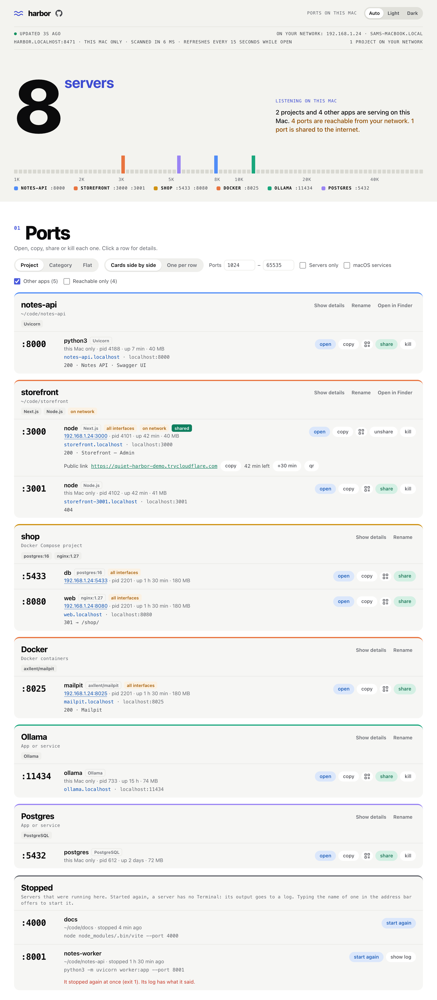

# harbor

Manfath was eating 25–40% of my CPU just to show which ports were open, because it ran `lsof`
every 10 seconds. So I made harbor. It sits in the menu bar, shows every server listening on my
Mac, and lets me open, copy, share or kill each one. It reads everything straight from the
kernel, so it idles at about 0% CPU.

<picture>
  <source media="(prefers-color-scheme: dark)" srcset="docs/screenshots/ports-dark.png">
  
</picture>

## What it does

The menu bar dropdown works like Manfath: ports grouped into dev servers, databases, runtimes
and so on, with open, share and kill on every row. Kill asks "confirm?" first and tells you which
process and folder it's about to stop. You can set a port range and hide processes you don't care
about. If you tick "macOS services", they're marked plainly: a "macOS service" badge on their card,
a grey card style and a macOS pill on each row.
The badge always counts exactly the rows the list shows, with the same range and filters.

It refreshes every 5, 15 (the default), 30 or 60 seconds while the menu or the page is open, or
every N seconds if you type your own (5 to 3600), or only when you press refresh. The menu and the
page use the same setting. If the menu bar badge is on (a count or a dot), harbor also scans at that
interval with everything closed, so the number stays right. With the badge off, nothing is scanned
until you look.

Like Manfath, it shows the network address in plain sight: the header says "On your network:
172.17.131.1 · Name.local" (or "Not on a network"), and each row shows where other devices reach it,
like `172.17.131.1:3000` (click to copy), or "this Mac only". It's read again on every scan, so a
new Wi-Fi shows up on the next refresh.

Every row has a QR button, and the QR is also in a row's details. A server on all interfaces gets
its network address as a QR for your phone on the same Wi-Fi. One bound to `127.0.0.1` can't be
reached from a phone, so it says so and offers share; once shared, the QR opens the public link.
A project that is on my network and shared at once shows both codes, each with what it is, its
link and its own copy.
The codes are drawn with soft squares and harbor's waves in the middle, and they stay dark on
white in dark mode too, because phones don't always read an inverted one.

For the full view, open harbor from Applications (or "Open harbor…" in the menu) and it opens
`harbor.localhost:8470` in your browser. That page groups ports by project, with the folder, the
framework, uptime and memory for each one. The tab shows harbor's wave icon and
"harbor • 9 ports".

Appearance is Auto, Light or Dark, and the menu and the page are set separately: the gear menu's
Appearance is for the dropdown, and the switch on the page (top right, and in Settings) is for the
page. Auto follows macOS. The menu bar icon always follows the menu bar.

harbor shows in the Dock by default. Clicking the Dock icon opens the page. "Show in Dock" in the
gear menu or the page's settings turns that off, and then it lives only in the menu bar.

Share puts a port on the internet through a Cloudflare quick tunnel and gives you a link and a
QR code. It always asks first, and the tunnel stops when you unshare, when the server stops, or
when harbor quits. You need `cloudflared` for this (`brew install cloudflared`); harbor never
installs anything itself. ngrok works too if you have it set up and no cloudflared.

There's also a small "This Mac" part: memory and swap, the apps using the most memory, and a
warning if stuck (zombie) processes start piling up. The menu bar icon turns orange or red when
memory gets tight.

## Names

Every project gets its own address. A server I start in `~/code/storefront` opens at
`storefront.localhost`, with no port to remember, and the address bar keeps that name. Hot reload
works through it. The dev server sees that name as its host. If one refuses it, allow `.localhost`
in its settings.

- The name is the folder's name in lowercase, with anything that isn't a letter or a number
  turned into a hyphen.
- If a project has several ports, the name goes to its dev server (or the lowest port) and the
  others get the port on the end, like `storefront-3001.localhost`.
- If two folders have the same name, the one that started first keeps it and the other gets its
  parent folder in front, like `blog-web.localhost`. A name doesn't change while its server runs.
- Apps without a folder get one too (`ollama.localhost`). `harbor` and `headroom` are taken.
  Databases don't get one, and neither does anything on a port browsers refuse to open.
- To rename one, open its row and click **rename** beside its `.localhost` link ("On this
  Mac", right above its name on the network), or right-click the row in the menu and choose
  **Rename…**. The name is saved for that folder. Leave it empty to go back to the automatic one.
- If a project has a front end and a back end, I can say which one its plain name opens:
  **make main** on the other server's row. The one that had the name goes by its port from then
  on (`storefront-3000.localhost`). The choice is kept; while that server isn't running, the
  usual rule decides.

The menu and the page show the name beside `localhost:3000`, and open and copy use the name.

Only harbor's door on port 80 knows the names, so harbor takes the door over when it opens (see
below), and headroom leaves it alone after that. If port 80 isn't harbor's, the names still work
with harbor's own port on the end, `storefront.localhost:8490`, and harbor shows them that way.

## On your network

A project can also get a name for the other devices on my Wi-Fi: `storefront.local`. It's off
until I turn it on for that project: **turn on** in the row's details, in the menu or on the
page, or right-click the row in the menu and choose **Put on Network as…**. Then my phone opens
`http://storefront.local/`, and the details show that link with copy and a QR code. It works for
a server that only listens on `127.0.0.1` too, because harbor passes the requests on.

- harbor suggests a password when I turn it on. I can keep it, type my own (8 characters or
  more; `12345678`, `password`, the project's name and the like are refused), or share without
  one, and then it asks first: "Anyone on this Wi-Fi can open storefront." (With two of its
  servers on the network it says so: "storefront's 2 servers".) The password is kept
  in a file only my account can read, like the sign-in session. (The Keychain would ask for my
  login password after every update, because harbor isn't signed with an Apple Developer ID.)
  In the details I can show it, change it, get a new random one or remove it.
  A visitor gets harbor's sign-in page first, and the password itself is never sent over the
  network.
- After 5 wrong passwords a device waits 5 minutes, and twice as long each time, up to an hour.
  If wrong ones keep coming from many devices, harbor tells me, and for 10 minutes every sign-in
  to that project takes two seconds longer.
- Every server of a project has its own switch. The main one is `storefront.local`, another is
  `storefront-8000.local`, and each can be renamed there. A share is for one server: if it stops
  or is started again, or another program starts listening on its port, it comes off the network
  and I turn it on again. It never moves to another server by itself, and choosing another main
  server takes the project off the network first. While something is on the network harbor
  keeps scanning, with the menu and the page closed too.
- The password is the project's: one for all its servers, and a visitor signs in once. A page
  on `storefront.local` can then call `storefront-8000.local`: harbor lets the project's own
  pages through from the device that signed in, which it knows by its address, while that
  device keeps using the name it signed in to (up to 15 minutes after its last request there).
  Another site's page open on the same device gets the sign-in page, and so does typing the
  back end's name into the address bar; I can sign in there too. The page has to call the back
  end by that name: a phone can't reach `localhost`. (The front end's own dev proxy is the
  simple way round that.) A page that sends no referrer (`Referrer-Policy: no-referrer`) can
  still fetch from the project's other server, but images and scripts loaded from it need the
  referrer. Devices behind one address, like a hotspot's, count as one device here.
- A sign-in is for the address it was made from. If my phone gets a new address it sees the
  sign-in page again and signs in again.
- The name on the network starts as the `.localhost` name. **Rename on Network…** (the same
  right-click menu, or **rename** beside the link) changes only that one, and it stays with
  that server when I make another one the main server. If another device
  already has the name, harbor takes the next free one, like `storefront-2.local`, and says so.
- It stops by itself when that server stops, when harbor quits, and when the Mac joins another
  network. Turning it off, changing the password or renaming it also cuts whatever visitors
  still had open, WebSockets too. After a restart nothing is on until I turn it on again. Names
  and passwords are kept.
- A row that is on the network says so in orange, and the menu's header and the top of the page
  count them: "1 project on your network".
- It needs port 80, which harbor's own door for the `.localhost` names is on too. So when the
  first project goes on the network, harbor takes the door away for a moment, opens its
  listener, and puts the door back. A page open at a `.localhost` name loses its connection
  for that moment and reconnects. If another program has port 80 (a web server), harbor says
  which one and shares nothing.

The first time, macOS asks whether harbor may find devices on local networks. If the firewall is
on, it asks once more when the first device connects: may harbor accept incoming connections.
Both need Allow, and until then the other device waits or can't find the name. If I said no:
System Settings → Privacy & Security → Local Network, and Network → Firewall → Options.

It's plain http on my network, so this is what a password does and doesn't do:

- It keeps out people browsing the Wi-Fi.
- Someone who captures the Wi-Fi's traffic can read the pages. A signed-in visitor's session
  they can reuse only if they also take over that device's address.
- Someone who can change the traffic can show a fake sign-in page and learn the password.
- While a password is set, anyone on the Wi-Fi can get in the way of sign-ins. They can't get in.

For anything private I use share instead.

The dev server sees `storefront.local` as its host. Vite answers "This host is not allowed"
until I add it in `vite.config.js`: `server: { allowedHosts: ['.local'] }`.

## Getting started

You need macOS 14 or newer.

1. **Check which Mac you have.** Apple menu → About This Mac. If it says "Chip" (Apple M1, M2…)
   you have Apple Silicon. If it says "Processor" (Intel Core…) you have Intel.
2. **Download the zip** from the [latest release](https://github.com/ips610/harbor/releases/latest),
   under Assets:
   - `harbor-apple-silicon.zip` for Apple Silicon
   - `harbor-intel.zip` for Intel
3. **Unzip it.** Safari does this by itself. Otherwise double-click the zip in Downloads. You get
   `harbor.app`. If you want to check the download, the release also has a `SHA256SUMS` file; in
   the Downloads folder run `shasum -a 256 -c SHA256SUMS` and it should say `OK`.
4. **Move it to Applications.** Drag `harbor.app` onto Applications in the Finder sidebar.
   Typing `harbor.localhost` only works once it runs from Applications.
5. **Open it the first time.** Double-click harbor in Applications. macOS says it can't check the
   app for malware, because I haven't paid Apple to notarise it. Click **Done** (not Move to
   Trash). Then open System Settings → Privacy & Security, scroll down to Security, and next to
   "harbor was blocked" click **Open Anyway**. Enter your password and click **Open Anyway** once
   more. You only do this once per download.
6. **Find it.** The waves icon appears in the menu bar, and harbor opens its page at
   `harbor.localhost` in your browser. macOS may say it added a background item: that's the small
   helper that lets you open harbor by typing the address. The first time you quit an app from
   harbor, macOS asks whether harbor may control it; allow it, or Quit won't work.
7. **Use it.** Click the waves for the list of ports, or keep the page open. Every row has open,
   copy, QR, share and kill. The gear menu has the port range, how often it refreshes, Open at
   login (off by default) and Show in Dock.

Only one harbor runs at a time; opening it again just brings up the page.

### Updating

When the menu or the page opens, harbor asks GitHub whether there's a newer version, at most once
a day. If there is, the menu and the page say "harbor 1.2 is out" with a **Get it** button.
**Check for Updates…** in the gear menu and **Check for updates** in the page's settings ask right
away. That check and Share are the only times harbor talks to the internet.

To update, quit harbor (gear menu → Quit harbor), download the new zip, unzip it and drag harbor
into Applications. Click **Replace** when Finder asks. A new download may need Open Anyway once
more. Opening the new one replaces the old one's helpers, even if the old one was still running.

### Typing the address

The first time harbor runs it adds a small LaunchAgent, `~/Library/LaunchAgents/local.harbor.plist`.
launchd then holds `127.0.0.1:8470` and `[::1]:8470` for me, and nothing runs until something
connects. So I can quit harbor, type `harbor.localhost:8470` in Safari, and it starts and shows the
page. If that browser is already signed in, the typed address (or a bookmark) just works. If it
isn't, harbor opens a signed-in tab itself and the tab I typed in says so. A link from another
website never makes harbor open anything. launchd holds port 8490 the same way; that's where the
names are answered, so going to `storefront.localhost` starts harbor too.

If another program already has 8470 on this Mac, harbor takes the next free port up to 8489 and
stays on it. It writes that port to `~/Library/Application Support/local.harbor/port`, the menu
and the page say "On port 8471: 8470 was in use", and `harbor.localhost` still lands on harbor,
because the door reads that file. headroom does the same from 8460.

harbor also sets up `local.localhost.door`. headroom adds one too, and harbor takes it over,
because only harbor's knows the names. It answers on port 80: `harbor.localhost` and
`headroom.localhost` are sent to the ports the two apps are on, and every other name goes to
harbor. It exits ten seconds after the last visit, or when the last page that came through it is
closed. If another program has port 80 itself, the bare names can't work; harbor says so and shows
the addresses with their ports.

When I quit harbor (from the menu, with ⌘Q or from the Dock), it stays quit. An open page that
asks in the background is told harbor has quit and stops asking, so it doesn't start harbor again
behind my back. Only typing the address or opening the app starts it again. A project's name
counts as typing the address when I go to it in the browser; a dev page left open that keeps
retrying doesn't.

### Uninstalling

Quit harbor and drag it from Applications to the Trash. Then paste this into Terminal to remove
its helper and settings:

```sh
launchctl bootout gui/$(id -u)/local.harbor 2>/dev/null
rm -f ~/Library/LaunchAgents/local.harbor.plist
defaults delete local.harbor 2>/dev/null
rm -rf ~/Library/Application\ Support/local.harbor
```

Only remove the door if headroom isn't using it either:

```sh
launchctl bootout gui/$(id -u)/local.localhost.door
rm ~/Library/LaunchAgents/local.localhost.door.plist
```

If you move the app to your own Applications folder instead, harbor fixes its helpers' paths the
next time you open it. A copy opened from anywhere else (Downloads, a build folder) leaves them alone.

## Building it yourself

You need Xcode 16 or newer.

```sh
./build.sh
./install.sh
open /Applications/harbor.app
```

`install.sh` puts it in `/Applications` and replaces a running copy. It then runs the new copy
with `--refresh-agents`, which reloads its helpers and starts it without opening the page. To rename the app, change
`app.conf` and build again. `./package.sh` makes the two zips for the Releases page; build it on
an Apple Silicon Mac.

`build.sh` signs with my own certificate ("IPS Local Apps") when that's in the keychain, so
macOS remembers what you allowed harbor to do after a rebuild. Without it, the app gets a
throwaway signature. Set `SIGN_ID` to use a different certificate.

## Why it's so light

It never runs `lsof`, `ps` or `netstat`. It asks the kernel directly (libproc, sysctl,
`host_statistics64`), so a full scan takes about 6–10 ms. With the menu and the page closed it only
does a tiny check once a minute, about 0.3 ms, for memory and stuck processes. Ports get scanned
only while you're looking at them, or at your refresh interval if the badge is on. Sharing is the one thing that starts another program
(`cloudflared`), and only when you click it.

On my Mac (16 GB, lots of swap in use):

| | CPU | Memory |
| --- | --- | --- |
| Nothing open, badge off | 0.01% | 9 MB |
| Nothing open, badge on (every 15 s) | 0.15% | 20 MB |
| Page open (every 15 s) | 0.15–0.25% | 20 MB |
| Menu open | 2.6% | 46 MB |

## Is it safe?

The page only listens on this Mac. The page itself has nothing secret in it; everything it shows
or does goes through calls that need a session. A tab is signed in by two things together: a
cookie, and a key the page keeps in the browser's storage for `harbor.localhost:8470` exactly.
Both come from a one-time link that harbor opens in your browser itself. Why two: a cookie alone
isn't tied to a port on localhost, so another program listening on a different port of the same
name could be sent it. The key never leaves harbor's own address, and the cookie is useless
without it. The sign-in lasts 30 days. No website can talk to the page, because it has neither
half (and POSTs need harbor's own header).

Names go through a second listener, also only on this Mac. It answers nothing but `.localhost`
names, so another website can't reach my dev servers through it, it only passes requests on to
servers harbor lists itself, never to harbor's or headroom's own pages, and it has nothing to do
with the sign-in above. Renaming goes through the signed-in page.

On network is the one thing that listens beyond this Mac, and only while a project is on. That
listener answers only what arrives on the address harbor announced, only for a Host that is
exactly a shared name. It never serves harbor's page, a `.localhost` name or a project I didn't
turn on. With a password, nothing reaches the project before the visitor has signed in on
harbor's own page, and only that page may send a try. Turning it off or changing the password
cuts every connection that was open for it.

harbor can only stop or share a process it just showed you, and it checks the process is still the
same one right before it acts, so a reused PID is safe. Stop sends a normal quit first and offers
force kill only if that didn't work. For a process owned by another user, like an antivirus, macOS
asks for your password in its own dialog, every time, and harbor never sees it. macOS's own
processes are never offered.

## Limits

Ports opened by other users (root) don't show up, the same as `lsof` without sudo. CPU % takes a
second to appear after you open the menu or the page.

A `.localhost` name is plain http and only works on this Mac. A `.local` name is plain http too,
IPv4 only, and lasts for the network the Mac was on when I turned it on.

## Debugging

The app binary has a few flags for testing: `--dump`, `--bench N`, `--serve`, `--no-open`,
`--proxy-port N`, `--lan-port N`, `--lan-suffix S`, `--lan-address A`, `--fixture [shared]`,
`--demo-menu --snapshot PATH`, `--expand PORT`, `--demo-lan PORT`, `--theme light|dark`,
`--show-system`, `--check-update`, `--door --door-port N` and `--test-stop PORT` (see
`Sources/Harbor/DebugCLI.swift`). Test runs never add a menu bar or Dock
icon, never take the keyboard, don't save settings, and use the next free port, so they can run
next to an installed copy.
